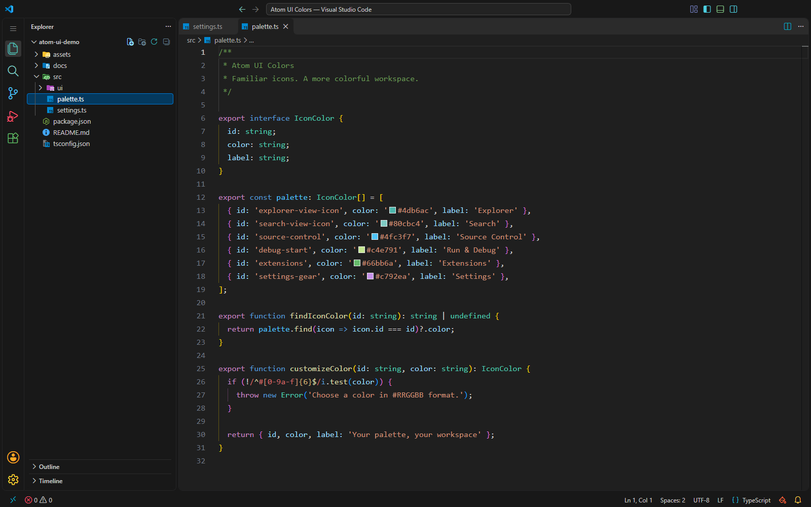

# Atom UI Colors

Add Atom Material colors to supported VS Code UI icons while keeping their original
shapes and sizes. File and folder icon themes stay unchanged.

See the [extension README](atom-ui-colors/README.md) for requirements,
customization and uninstall instructions. Uninstall cleanup is automatic;
choose **Reload Window** when prompted to return to the previous appearance.

Extension ID: `maskennetwork.atom-ui-colors`.

Source: `atom-ui-colors/`. Run `node --test` from that directory to check the
source, and use the official VS Code extension packager to prepare a VSIX.
