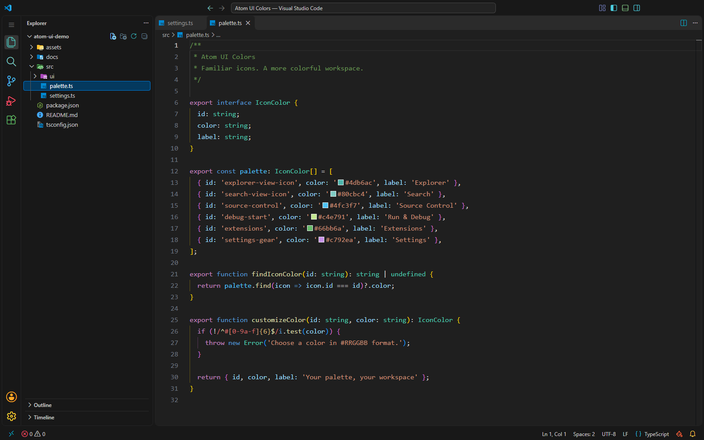
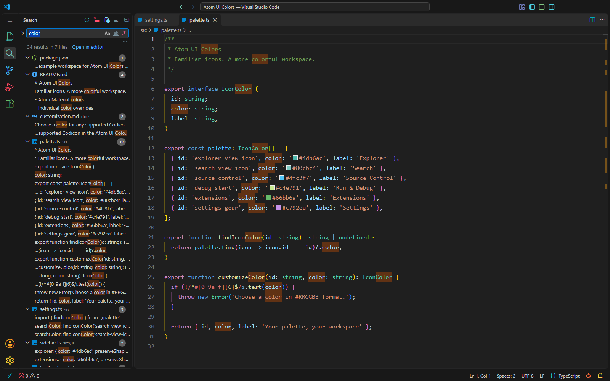
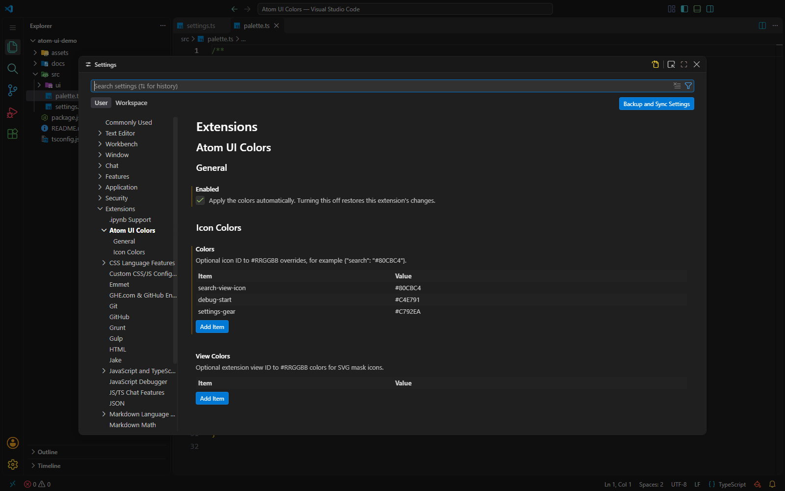

# Atom UI Colors

**Your familiar icons. A more colorful workspace.**

Keep VS Code's native UI icons and give them colors from Atom Material Icons,
with explicit theme-color fallbacks. Extension view logos use colors extracted
from their own SVGs. File and folder icon themes remain entirely independent.
This project is not affiliated with AtomMaterialUI or Microsoft.



## A little color, right where you work

- **Familiar shapes.** Keep the icons supplied by VS Code or your product icon theme.
- **Atom Material colors.** Distinct colors for search, source control, debugging,
  settings and hundreds of supported UI icons.
- **Your file icons.** Keep your existing file and folder icon theme independently.
- **Your palette.** Override individual icon colors with simple `#RRGGBB` settings.
- **An easy way back.** Restore the previous appearance with a dedicated command.





**Desktop VS Code only: Windows, macOS and Linux.** The extension uses app-relative
paths and Node's platform APIs; it does not run PowerShell, Bash, AppleScript or
administrator commands. VS Code for the Web is not supported.

## Installation and first use

1. Install the VSIX with **Extensions: Install from VSIX**, or install from the
   Marketplace once a public publisher and listing have been configured.
2. VS Code installs the declared dependency **Custom CSS and JS Loader**
   (`be5invis.vscode-custom-css`). Its installation may require Marketplace access
   and the normal publisher-trust confirmation. Offline users must install its
   VSIX separately before installing this extension.
3. At startup, Atom UI Colors creates a per-profile `icons.css` under
   `~/.atom-ui-colors/profiles/<profile-hash>/`, adds its correctly encoded file URL
   to `vscode_custom_css.imports`, activates the Loader, and executes
   **Enable Custom CSS and JS** (`extension.installCustomCSS`). Existing imports
   are kept in order.
4. Accept the Loader's **Restart Visual Studio Code** / reload-window action.
   The extension does not restart the editor without user action.

The Loader's Enable command also applies changed CSS. Atom UI Colors uses that
command for repair instead of Reload, because Reload deletes the Loader's
existing backup files. Existing settings and the workbench HTML are recorded
before the first modification.

## Installation permissions

CSS injection modifies a file inside the VS Code application. It works only when
that installation is writable by your user. It can trigger VS Code's integrity
warning; this is an inherent consequence of Custom CSS and JS Loader.

| System | Suitable installation | Protected installations |
| --- | --- | --- |
| Windows | Per-user VS Code installer or user-owned portable installation | A system-wide Program Files installation may require administrator-managed write access. |
| macOS | User-owned VS Code app, including a user-owned `~/Applications` app | Managed, read-only or protected app bundles must be made writable by their administrator. |
| Linux | User-owned VS Code archive installation | `/usr/share`, `/opt`, Snap or other protected installations may reject patching. Use a writable installation or ask its administrator. |

The extension never changes file permissions or elevates privileges. If the
Loader cannot patch the application, Atom UI Colors detects the failure, rolls
back its configuration changes, and reports the error in **Output → Atom UI
Colors**. Recovery data is retained if rollback itself is blocked by permissions.

Remote SSH/WSL/containers use the local desktop UI: this extension and its Loader
dependency run locally (`extensionKind: ui`). It does not patch the remote server.

## What changes

- `color` on Codicon pseudo-elements and `background-color` on extension SVG
  masks. SVG backgrounds on dedicated toolbar and tree icon elements use the
  same SVG resource as an alpha mask to apply its predominant color. No glyph,
  SVG file, font, element dimensions or layout is replaced.
- Hover colors stay colored; disabled icons and high-contrast themes retain the
  theme's defaults. Badges and text labels are not recolored.
- The existing product icon theme is respected. Select **Default** in
  **Preferences: Product Icon Theme** if you want the stock Codicon shapes.
- File/folder icon themes, including Material Icon Theme, are never selected,
  installed or modified by this extension.
- Every Codicon and extension view URI mask receives an explicit color rule,
  including icons without an Atom Material match. Their fallback uses the current
  VS Code theme's normal icon color for the surrounding UI, consistently on hover.
  Isolated webviews, canvas content and operating-system native menus are not
  reachable by this CSS.

The palette is derived from Atom Material Icons 210.0.2. For multicolor originals,
the most frequent explicit fill/stroke is used; ties select the first color.
This is a single-color interpretation of those originals, not a full SVG port.

Codicon aliases without an explicit palette entry inherit a mapped reference's
color. Existing explicit palette entries and user overrides take precedence.
A bundled official Codicon catalog is supplemented with registration data from
the installed VS Code application and extension icon contributions. A generic
explicit fallback also covers future or dynamically contributed icon IDs.

Extension view/container SVG colors are discovered locally from installed
extension manifests, including SVG resources contributed by toolbar commands.
There is no built-in list of extension brand colors and
no Marketplace or logo lookup. The analyzer renders each SVG at up to 256 pixels
on its longest side and estimates each paint's visible, alpha-weighted area,
including overlaps and CSS/inherited paints. Equal areas select the first color
in SVG document order. A neutral color explicitly declared in the SVG is valid;
missing paints and context colors such as `currentColor` use the theme fallback.
Unreadable, oversized or unsupported SVGs also receive that fallback. Analysis
runs in bounded workers with an offline, bundled WebAssembly renderer; external
images, scripts and fonts are not loaded.

At startup and when extensions are installed, updated, enabled, disabled or
removed, the extension rediscovers icons and regenerates CSS when needed.
Bursts of changes are grouped. Theme changes also refresh light/dark SVG variants;
theme fallback colors follow VS Code's CSS variables. The Loader still requires
a window reload to display newly generated CSS. Automatic refresh stays paused
after **Restore Previous Appearance** and while `atomUIColors.enabled` is false.

## Commands and customization

- **Atom UI Colors: Apply / Repair Colors** regenerates CSS and applies it. Use
  this after updating VS Code, changing product icon themes or re-enabling the Loader.
- **Atom UI Colors: Restore Previous Appearance** removes the extension's current
  changes and pauses automatic application. Apply / Repair resumes it.
- **Atom UI Colors: Open Generated CSS Folder** opens the per-profile CSS folder.
- **Atom UI Colors: Show Status** opens the diagnostic output and stored state.

Optional local user settings:

```jsonc
{
  "atomUIColors.enabled": true,
  "atomUIColors.colors": {
    "search": "#80CBC4",
    "search-view-icon": "#80CBC4"
  },
  "atomUIColors.viewColors": {
    "myExtension.view": "#FFCA28"
  }
}
```

Colors accept `#RRGGBB`. Invalid IDs or colors are rejected before application.
The settings use machine scope because generated file URLs are machine-local.
Avoid syncing `vscode_custom_css.imports` between different computers; its file
URLs are local. Each machine generates its own CSS at startup.

If a workspace overrides `vscode_custom_css.imports`, remove that override first.
Atom UI Colors will not overwrite workspace or project settings. The Loader's
CSS modifies the shared desktop application: active colors can affect all windows
using that same VS Code installation, including windows with another profile.

## Restore and uninstall

For an immediate restore, execute **Atom UI Colors: Restore Previous Appearance**
and reload the window. Turning `atomUIColors.enabled` off also restores the changes.

Normal uninstall registers the documented `vscode:uninstall` Node hook. **Quit all
VS Code processes and start the application again after uninstalling**; a window
reload alone is not guaranteed to run that hook. If the extension is still
installed in another profile, complete removal and its uninstall hook can be
deferred until it is removed there too.

The hook:

1. Restores the original workbench HTML and user settings byte-for-byte if they
   have not changed since application.
2. Otherwise removes only this extension's marked CSS and generated import URL,
   preserving other CSS, comments, user settings and later edits.
3. Removes the generated CSS, state files and unchanged Loader backups created
   by this extension. It never recursively deletes user directories.

The shared Loader dependency remains installed, as is normal for dependencies;
it can be uninstalled separately when no other extension or CSS uses it. It is
not disabled globally, so other custom CSS keeps working. User-entered
`atomUIColors.*` preferences are not erased. Empty storage directories may remain.

Recovery snapshots live under `~/.atom-ui-colors/`. They may contain your original
settings, so do not publish or synchronize them. Failed cleanup keeps recovery
data and reports the failure to the uninstall log. From the extension's source
directory, `node src/uninstall.cjs` runs the same hook for that extensions directory;
the in-editor Restore command is preferred while the extension is installed.

Settings JSONC is edited with Microsoft's jsonc-parser, preserving unrelated
comments and values. Damaged settings are reported rather than overwritten.

## Updates and limitations

At startup, the extension checks whether its exact CSS is present. It repairs a
missing patch, such as after a VS Code update, without writing files on every
startup. CSS class names are private implementation details and can change in
future editor or Loader releases. Current tests target the Loader 7.5.1 command
contract and both electron-browser/electron-sandbox workbench layouts.

Forced process termination, removing extension folders manually, read-only files,
or disabling the uninstall hook can prevent automatic cleanup. Use Restore
before removal when possible. No extension can guarantee writes to protected
installations without the operating system allowing them.

## Development and distribution

The public author is **MaskenNetwork**. The Marketplace publisher is
`maskennetwork`; the extension ID is `maskennetwork.atom-ui-colors`.
Source and issue tracking are hosted on
[GitHub](https://github.com/MaskenNetwork/Atom_UI_Colors).

### Moving from the local development build

If you installed an earlier local development build under a different ID, first
run **Restore Previous Appearance** in that build, uninstall it, then quit all
VS Code processes and start VS Code again so its uninstall hook can finish.
Install Atom UI Colors after that cleanup and keep a single copy installed.
If the earlier build used different setting keys, copy your custom color values
to `atomUIColors.colors` and `atomUIColors.viewColors`. The new build uses its own
`~/.atom-ui-colors/` recovery directory and does not modify earlier recovery data.

Node.js 22 or newer is recommended for development. Runtime has no npm install
step: jsonc-parser is vendored with its license and the palette is bundled.

```sh
node --test
node scripts/package.cjs
```

The package is written to `../atom-ui-colors-0.1.3.vsix`. Only `src`, `assets`,
`media`, `vendor`, manifest, notices and documentation are distributed. Tests, personal
paths, recovery snapshots, old SVG assets and local browser profiles are excluded.

Before Marketplace publication:

1. The publisher is configured as `maskennetwork` and the public author as
   `MaskenNetwork`.
2. Repository, issue tracker and homepage point to the public GitHub repository.
   The Marketplace icon and screenshots are included under `media/`.
3. Run the Windows/macOS/Linux test matrix and test first install, upgrades,
   permissions failures, profiles and complete uninstall in disposable VS Code
   installations with the real Loader. Tests included here use controlled Loader
   fixtures and do not certify real macOS/Linux installations by themselves.
4. Package with `npx @vscode/vsce@4.1.1 package --no-dependencies`, inspect its
   contents, and publish with your publisher account. The manifest configures
   README link and image bases for the `atom-ui-colors/` source directory on
   `main`. Publishing is a separate explicit action.

The root repository's `.github/workflows/atom-ui-colors.yml` runs the lifecycle
tests on all three operating systems. The package script also works without npm.

The visible name is Atom UI Colors, the package name is `atom-ui-colors`, and the
full extension ID is `maskennetwork.atom-ui-colors`. Commands and settings use
`atomUIColors.*`; recovery data uses `~/.atom-ui-colors/`; generated CSS is marked
`ATOM-UI-COLORS`. Earlier development builds have separate identities; follow the
migration instructions above before replacing them.

References: [extension manifest and uninstall hook](https://code.visualstudio.com/api/references/extension-manifest#extension-uninstall-hook),
[Loader source](https://github.com/be5invis/vscode-custom-css),
[VS Code customization restrictions](https://code.visualstudio.com/api/extension-capabilities/overview#restrictions).
